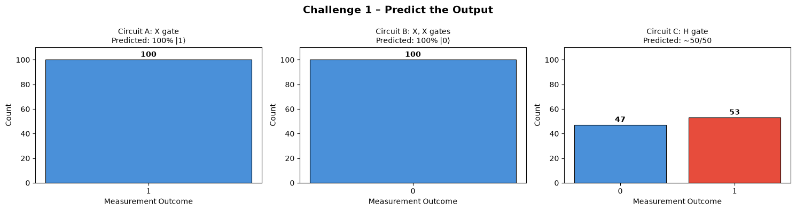
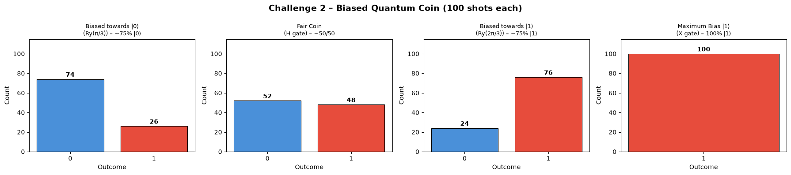
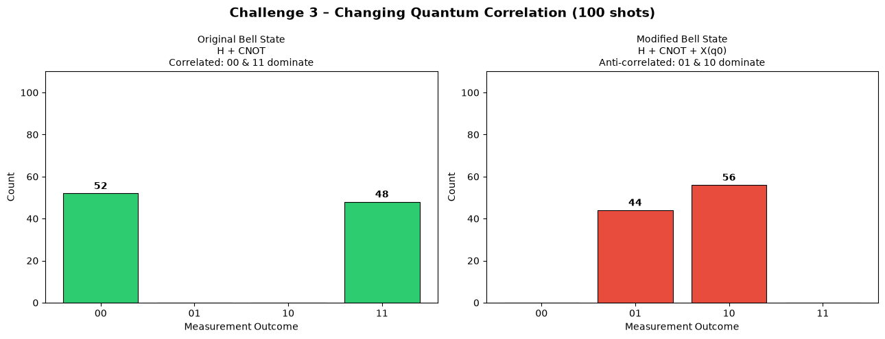
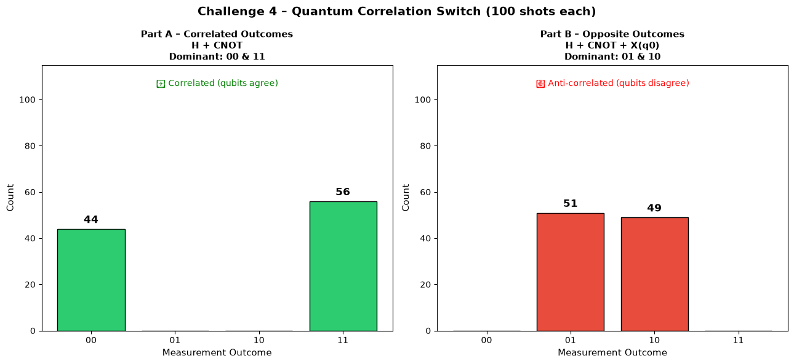

# Qiskit Fall Fest 2026 — Challenges 1 to 4 Complete Solutions

> **Vishnu Institute of Technology — Quantum Computing Initiative**  
> Complete theoretical documentation, mathematical analysis, circuit diagrams, implementation code, and simulation results for all four IBM Qiskit Fall Fest 2026 challenges.

---

## Table of Contents
1. [Overview & Repository Structure](#overview--repository-structure)
2. [Environment Setup & Installation](#environment-setup--installation)
3. [Challenge 1: Predict the Output](#challenge-1-predict-the-output)
   - [Problem Statement](#challenge-1-problem-statement)
   - [Theoretical Foundations](#challenge-1-theoretical-foundations)
   - [Circuit Designs & State Transformations](#challenge-1-circuits)
   - [Predictions vs. Experimental Results](#challenge-1-results)
   - [Code Implementation](#challenge-1-code)
   - [Key Insights](#challenge-1-key-insights)
4. [Challenge 2: Make the Quantum Coin Biased](#challenge-2-make-the-quantum-coin-biased)
   - [Problem Statement](#challenge-2-problem-statement)
   - [Theoretical Foundations & Bloch Sphere Rotation](#challenge-2-theoretical-foundations)
   - [Analytical Probability Derivations](#challenge-2-derivations)
   - [Circuit Configurations Tested](#challenge-2-circuits)
   - [Experimental Verification & Histogram](#challenge-2-results)
   - [Code Implementation](#challenge-2-code)
   - [Key Insights](#challenge-2-key-insights)
5. [Challenge 3: Can You Change the Correlation?](#challenge-3-can-you-change-the-correlation)
   - [Problem Statement](#challenge-3-problem-statement)
   - [Entanglement & Bell State Theory](#challenge-3-theoretical-foundations)
   - [Switching Parity with Local Unitary Operators](#challenge-3-switching-parity)
   - [Circuits: Correlated vs. Anti-Correlated](#challenge-3-circuits)
   - [Experimental Verification & Comparison](#challenge-3-results)
   - [Code Implementation](#challenge-3-code)
   - [Key Insights](#challenge-3-key-insights)
6. [Challenge 4: Quantum Correlation Switch](#challenge-4-quantum-correlation-switch)
   - [Problem Statement](#challenge-4-problem-statement)
   - [Architectural Design & Gate Budget](#challenge-4-design)
   - [Part A (Correlated) & Part B (Opposite) Analysis](#challenge-4-parts)
   - [Simulation Statistics & Verification](#challenge-4-results)
   - [Code Implementation](#challenge-4-code)
   - [Key Insights](#challenge-4-key-insights)
7. [Comprehensive Summary Matrix](#comprehensive-summary-matrix)
8. [How to Run the Notebook](#how-to-run-the-notebook)

---

## Overview & Repository Structure

This repository contains the complete, verified solutions for all four challenges of the **Qiskit Fall Fest 2026**. Each challenge explores foundational quantum mechanics principles: single-qubit state manipulation, arbitrary superposition via rotation gates, quantum entanglement creation (EPR pairs), and local control over non-local quantum correlations.

```
qiskit/
├── README.md                              # Full theoretical and practical documentation
├── .gitignore                             # Git ignore rules for notebooks and caches
├── qiskit_fallfest_challenges_1to4.ipynb  # Executable Jupyter notebook with all outputs
├── challenge1_results.png                 # Measurement histograms for Challenge 1
├── challenge2_results.png                 # Measurement histograms for Challenge 2
├── challenge3_results.png                 # Measurement histograms for Challenge 3
└── challenge4_results.png                 # Measurement histograms for Challenge 4
```

---

## Environment Setup & Installation

To run the notebook and reproduce these results locally:

```bash
# 1. Clone this repository
git clone https://github.com/akash2236/qiskit.git
cd qiskit

# 2. Install required packages
pip install qiskit==2.5.2 qiskit-aer==0.17.2 matplotlib numpy

# 3. Launch Jupyter Notebook
jupyter notebook qiskit_fallfest_challenges_1to4.ipynb
```

**Simulator Specifications:**
- **Backend:** `AerSimulator` (from `qiskit_aer`)
- **Shots:** `100` per experiment
- **Execution framework:** Qiskit 2.x API with `transpile()` and `backend.run()`

---

## Challenge 1: Predict the Output

### Challenge 1: Problem Statement
A quantum circuit produces measurement outcomes depending on the unitary gates applied to its qubits. The objective of Challenge 1 is to:
1. Examine three single-qubit quantum circuits (Circuit A, Circuit B, and Circuit C).
2. Analytically calculate and predict the measurement outcome probabilities **before** running any simulation.
3. Simulate the circuits using `AerSimulator` with 100 shots.
4. Compare theoretical predictions with actual simulation counts, identifying deterministic versus probabilistic behavior.

---

### Challenge 1: Theoretical Foundations

#### Qubit Computational Basis
In quantum computing, a single qubit exists in a two-dimensional Hilbert space spanned by the orthonormal computational basis vectors:
$$|0\rangle = \begin{pmatrix} 1 \\ 0 \end{pmatrix}, \quad |1\rangle = \begin{pmatrix} 0 \\ 1 \end{pmatrix}$$

#### Pauli-X Gate (Quantum NOT)
The Pauli-$X$ gate is the quantum analogue of the classical NOT gate, represented by the unitary matrix:
$$X = \begin{pmatrix} 0 & 1 \\ 1 & 0 \end{pmatrix}$$
- Applied to $|0\rangle$:
  $$X|0\rangle = \begin{pmatrix} 0 & 1 \\ 1 & 0 \end{pmatrix} \begin{pmatrix} 1 \\ 0 \end{pmatrix} = \begin{pmatrix} 0 \\ 1 \end{pmatrix} = |1\rangle$$
- Applied to $|1\rangle$:
  $$X|1\rangle = \begin{pmatrix} 0 & 1 \\ 1 & 0 \end{pmatrix} \begin{pmatrix} 0 \\ 1 \end{pmatrix} = \begin{pmatrix} 1 \\ 0 \end{pmatrix} = |0\rangle$$
- Unitary self-inverse property:
  $$X^2 = X \cdot X = \begin{pmatrix} 0 & 1 \\ 1 & 0 \end{pmatrix} \begin{pmatrix} 0 & 1 \\ 1 & 0 \end{pmatrix} = \begin{pmatrix} 1 & 0 \\ 0 & 1 \end{pmatrix} = I$$

#### Hadamard Gate (Superposition Operator)
The Hadamard ($H$) gate creates an equal superposition of $|0\rangle$ and $|1\rangle$:
$$H = \frac{1}{\sqrt{2}}\begin{pmatrix} 1 & 1 \\ 1 & -1 \end{pmatrix}$$
$$H|0\rangle = \frac{1}{\sqrt{2}}|0\rangle + \frac{1}{\sqrt{2}}|1\rangle = |+\rangle$$

According to Born's Rule, the probability $P(m)$ of obtaining measurement outcome $m \in \{0, 1\}$ from state $|\psi\rangle$ is:
$$P(0) = |\langle 0|\psi\rangle|^2, \quad P(1) = |\langle 1|\psi\rangle|^2$$

---

### Challenge 1: Circuits

#### Circuit A: Single Pauli-X Gate
```
     ┌───┐┌─┐
  q: ┤ X ├┤M├
     └───┘└╥┘
c: 1/══════╩═
           0 
```
- **Initial state:** $|0\rangle$
- **Final state:** $|\psi_A\rangle = X|0\rangle = |1\rangle$
- **Expected Outcome:** 100% $|1\rangle$ (Deterministic)

#### Circuit B: Double Pauli-X Gate ($X \cdot X$)
```
     ┌───┐┌───┐┌─┐
  q: ┤ X ├┤ X ├┤M├
     └───┘└───┘└╥┘
c: 1/═══════════╩═
                0 
```
- **Initial state:** $|0\rangle$
- **Final state:** $|\psi_B\rangle = X(X|0\rangle) = X|1\rangle = |0\rangle$
- **Expected Outcome:** 100% $|0\rangle$ (Deterministic)

#### Circuit C: Single Hadamard Gate ($H$)
```
     ┌───┐┌─┐
  q: ┤ H ├┤M├
     └───┘└╥┘
c: 1/══════╩═
           0 
```
- **Initial state:** $|0\rangle$
- **Final state:** $|\psi_C\rangle = H|0\rangle = \frac{1}{\sqrt{2}}|0\rangle + \frac{1}{\sqrt{2}}|1\rangle$
- **Expected Outcome:** 50% $|0\rangle$, 50% $|1\rangle$ (Probabilistic)

---

### Challenge 1: Predictions vs. Experimental Results

| Circuit | Gates Applied | Theoretical State | Predicted $P(0)$ | Predicted $P(1)$ | Actual Counts (100 shots) | Behavior |
| :--- | :--- | :--- | :---: | :---: | :---: | :---: |
| **Circuit A** | $X$ | $\|1\rangle$ | 0% | 100% | `{'1': 100}` | Deterministic |
| **Circuit B** | $X, X$ | $\|0\rangle$ | 100% | 0% | `{'0': 100}` | Deterministic |
| **Circuit C** | $H$ | $\frac{\|0\rangle + \|1\rangle}{\sqrt{2}}$ | 50% | 50% | `{'0': 47, '1': 53}` | Probabilistic |



---

### Challenge 1: Code Implementation

```python
from qiskit import QuantumCircuit, transpile
from qiskit_aer import AerSimulator

simulator = AerSimulator()

# Circuit A: Single X gate
qc_A = QuantumCircuit(1, 1)
qc_A.x(0)
qc_A.measure(0, 0)

# Circuit B: Two X gates
qc_B = QuantumCircuit(1, 1)
qc_B.x(0)
qc_B.x(0)
qc_B.measure(0, 0)

# Circuit C: Hadamard gate
qc_C = QuantumCircuit(1, 1)
qc_C.h(0)
qc_C.measure(0, 0)

# Execute 100 shots each
for name, qc in [("A", qc_A), ("B", qc_B), ("C", qc_C)]:
    compiled = transpile(qc, simulator)
    counts = simulator.run(compiled, shots=100).result().get_counts()
    print(f"Circuit {name} Counts: {counts}")
```

### Challenge 1: Key Insights
1. **Deterministic Gates:** Circuits A and B produce invariant results regardless of the number of shots because their state vectors are aligned with computational basis vectors.
2. **Reversibility of Quantum Operations:** Because all quantum gates are unitary ($U^\dagger U = I$) and $X$ is Hermitian ($X^\dagger = X$), applying $X$ twice acts as the identity operator ($X^2 = I$).
3. **True Quantum Randomness:** Circuit C does not produce 50/50 exactly every run; rather, each shot is an independent Bernoulli trial with $p = 0.5$, demonstrating intrinsic quantum indeterminism.

---

## Challenge 2: Make the Quantum Coin Biased

### Challenge 2: Problem Statement
The Hadamard gate produces a strictly "fair" quantum coin toss where $P(0) = P(1) = 0.5$. The goal of Challenge 2 is to:
1. Design a quantum circuit that creates a **biased quantum coin** with arbitrary measurement probabilities.
2. Target a bias toward $|0\rangle$ ($P(0) \approx 75\%$, $P(1) \approx 25\%$).
3. Target a bias toward $|1\rangle$ ($P(0) \approx 25\%$, $P(1) \approx 75\%$).
4. Demonstrate how continuous rotation angles on the Bloch sphere allow precise tuning of quantum state probabilities.

---

### Challenge 2: Theoretical Foundations & Bloch Sphere Rotation

Any pure single-qubit state can be represented as a point on the unit sphere in 3D space (the **Bloch Sphere**):
$$|\psi(\theta, \phi)\rangle = \cos\left(\frac{\theta}{2}\right)|0\rangle + e^{i\phi}\sin\left(\frac{\theta}{2}\right)|1\rangle$$
where:
- $\theta \in [0, \pi]$ represents the polar angle from the $|0\rangle$ state (north pole).
- $\phi \in [0, 2\pi)$ represents the azimuthal phase angle.

#### The $R_y(\theta)$ Rotation Gate
The single-qubit rotation gate around the $Y$-axis on the Bloch sphere is defined as:
$$R_y(\theta) = \exp\left(-i\frac{\theta}{2}Y\right) = \begin{pmatrix} \cos(\theta/2) & -\sin(\theta/2) \\ \sin(\theta/2) & \cos(\theta/2) \end{pmatrix}$$

Applying $R_y(\theta)$ to the initial state $|0\rangle$:
$$R_y(\theta)|0\rangle = \begin{pmatrix} \cos(\theta/2) & -\sin(\theta/2) \\ \sin(\theta/2) & \cos(\theta/2) \end{pmatrix} \begin{pmatrix} 1 \\ 0 \end{pmatrix} = \cos\left(\frac{\theta}{2}\right)|0\rangle + \sin\left(\frac{\theta}{2}\right)|1\rangle$$

---

### Challenge 2: Analytical Probability Derivations

Applying Born's rule yields:
$$P(0) = \left|\cos\left(\frac{\theta}{2}\right)\right|^2 = \cos^2\left(\frac{\theta}{2}\right)$$
$$P(1) = \left|\sin\left(\frac{\theta}{2}\right)\right|^2 = \sin^2\left(\frac{\theta}{2}\right)$$

#### 1. Biased toward $|0\rangle$ (75% / 25%)
We solve for $\theta$:
$$\cos^2\left(\frac{\theta}{2}\right) = 0.75 = \frac{3}{4} \implies \cos\left(\frac{\theta}{2}\right) = \frac{\sqrt{3}}{2} \implies \frac{\theta}{2} = \frac{\pi}{6} \implies \mathbf{\theta = \frac{\pi}{3}} \approx 1.0472\text{ rad } (60^\circ)$$

#### 2. Fair Coin (50% / 50%)
$$\cos^2\left(\frac{\theta}{2}\right) = 0.50 = \frac{1}{2} \implies \frac{\theta}{2} = \frac{\pi}{4} \implies \mathbf{\theta = \frac{\pi}{2}} \approx 1.5708\text{ rad } (90^\circ)$$

#### 3. Biased toward $|1\rangle$ (25% / 75%)
$$\cos^2\left(\frac{\theta}{2}\right) = 0.25 = \frac{1}{4} \implies \cos\left(\frac{\theta}{2}\right) = \frac{1}{2} \implies \frac{\theta}{2} = \frac{\pi}{3} \implies \mathbf{\theta = \frac{2\pi}{3}} \approx 2.0944\text{ rad } (120^\circ)$$

#### 4. Maximum Bias toward $|1\rangle$ (0% / 100%)
$$\theta = \pi \implies \cos^2\left(\frac{\pi}{2}\right) = 0, \quad \sin^2\left(\frac{\pi}{2}\right) = 1.0 \implies \mathbf{\theta = \pi} (180^\circ) \equiv X\text{ gate}$$

---

### Challenge 2: Circuits

```
Biased towards |0⟩ (θ = π/3):
     ┌─────────┐┌─┐
  q: ┤ Ry(π/3) ├┤M├
     └─────────┘└╥┘
c: 1/════════════╩═
                 0 

Biased towards |1⟩ (θ = 2π/3):
     ┌──────────┐┌─┐
  q: ┤ Ry(2π/3) ├┤M├
     └──────────┘└╥┘
c: 1/═════════════╩═
                  0 
```

---

### Challenge 2: Experimental Verification & Histogram

| Configuration | Gate Parameter $\theta$ | Analytical $P(0)$ | Analytical $P(1)$ | Simulation Counts (100 shots) |
| :--- | :---: | :---: | :---: | :---: |
| **Biased towards $\|0\rangle$** | $\pi/3$ ($60^\circ$) | 75.0% | 25.0% | `{'0': 74, '1': 26}` |
| **Fair Coin (Reference)** | $\pi/2$ ($90^\circ$) | 50.0% | 50.0% | `{'0': 48, '1': 52}` |
| **Biased towards $\|1\rangle$** | $2\pi/3$ ($120^\circ$) | 25.0% | 75.0% | `{'0': 24, '1': 76}` |
| **Max Bias $\|1\rangle$** | $\pi$ ($180^\circ$) or $X$ | 0.0% | 100.0% | `{'1': 100}` |



---

### Challenge 2: Code Implementation

```python
import math
from qiskit import QuantumCircuit, transpile
from qiskit_aer import AerSimulator

simulator = AerSimulator()

def create_biased_coin(theta):
    qc = QuantumCircuit(1, 1)
    qc.ry(theta, 0)
    qc.measure(0, 0)
    return qc

angles = {
    "Biased towards |0>": math.pi / 3,
    "Fair Coin": math.pi / 2,
    "Biased towards |1>": 2 * math.pi / 3,
    "Maximum Bias |1>": math.pi
}

for label, theta in angles.items():
    qc = create_biased_coin(theta)
    compiled = transpile(qc, simulator)
    counts = simulator.run(compiled, shots=100).result().get_counts()
    print(f"{label} (theta={theta:.4f}): {counts}")
```

### Challenge 2: Key Insights
- Unlike classical bits which are restricted to $\{0, 1\}$, a qubit's state space is a continuous two-dimensional manifold (the 2-sphere).
- By adjusting the rotation angle $\theta$ of the $R_y$ gate, one can synthesize any desired probability distribution $P(0) \in [0, 1]$.
- Quantum algorithms (e.g., Grover's Search and Quantum Phase Estimation) utilize continuous amplitude rotations to amplify target probabilities.

---

## Challenge 3: Can You Change the Correlation?

### Challenge 3: Problem Statement
Quantum entanglement establishes non-classical correlations between qubits.
1. Implement the canonical Bell-state circuit using a Hadamard gate and a Controlled-NOT (CNOT) gate.
2. Observe that measurement outcomes are strongly correlated (`00` and `11`).
3. Modify the circuit with a minimal gate modification to alter the relationship between the two measurement outcomes.
4. Investigate and prove how the correlation transforms into anti-correlation (`01` and `10`).

---

### Challenge 3: Entanglement & Bell State Theory

The four maximally entangled two-qubit Bell states (EPR pairs) form a complete orthonormal basis for $\mathbb{C}^4$:
$$|\Phi^+\rangle = \frac{|00\rangle + |11\rangle}{\sqrt{2}}, \quad |\Phi^-\rangle = \frac{|00\rangle - |11\rangle}{\sqrt{2}}$$
$$|\Psi^+\rangle = \frac{|01\rangle + |10\rangle}{\sqrt{2}}, \quad |\Psi^-\rangle = \frac{|01\rangle - |10\rangle}{\sqrt{2}}$$

#### Generating the Canonical Bell State $|\Phi^+\rangle$:
1. **Initial state:** $|\psi_0\rangle = |00\rangle$
2. **Apply $H$ to qubit 0 ($H \otimes I$):**
   $$|\psi_1\rangle = (H|0\rangle) \otimes |0\rangle = \left(\frac{|0\rangle + |1\rangle}{\sqrt{2}}\right)|0\rangle = \frac{|00\rangle + |10\rangle}{\sqrt{2}}$$
3. **Apply $CNOT$ with control qubit 0 and target qubit 1:**
   $$CNOT|00\rangle = |00\rangle, \quad CNOT|10\rangle = |11\rangle$$
   $$|\psi_2\rangle = \frac{|00\rangle + |11\rangle}{\sqrt{2}} = |\Phi^+\rangle$$

Measurement in the computational basis yields only outcomes with even parity:
$$P(00) = 0.5, \quad P(11) = 0.5, \quad P(01) = 0, \quad P(10) = 0$$

---

### Challenge 3: Switching Parity with Local Unitary Operators

To invert the correlation from matching (`00`, `11`) to opposing (`01`, `10`), we apply a single Pauli-$X$ gate to qubit 0 **after** entanglement has been established:
$$(X \otimes I)|\Phi^+\rangle = (X \otimes I)\left(\frac{|00\rangle + |11\rangle}{\sqrt{2}}\right) = \frac{(X|0\rangle)|0\rangle + (X|1\rangle)|1\rangle}{\sqrt{2}} = \frac{|10\rangle + |01\rangle}{\sqrt{2}} = |\Psi^+\rangle$$

Note that in Qiskit's standard little-endian bit-ordering convention, qubit 0 is the least significant bit (rightmost in bitstrings):
- $|1\rangle_{q_0}|0\rangle_{q_1} \implies \text{bitstring } \mathbf{01}$
- $|0\rangle_{q_0}|1\rangle_{q_1} \implies \text{bitstring } \mathbf{10}$

Measurement now produces only outcomes with odd parity:
$$P(01) = 0.5, \quad P(10) = 0.5, \quad P(00) = 0, \quad P(11) = 0$$

---

### Challenge 3: Circuits

#### Original Bell Circuit ($|\Phi^+\rangle$ — Correlated)
```
     ┌───┐     ┌─┐   
q_0: ┤ H ├──■──┤M├───
     └───┘┌─┴─┐└╥┘┌─┐
q_1: ─────┤ X ├─╫─┤M├
          └───┘ ║ └╥┘
c: 2/═══════════╩══╩═
                0  1 
```

#### Modified Bell Circuit ($|\Psi^+\rangle$ — Anti-Correlated)
```
     ┌───┐     ┌───┐┌─┐
q_0: ┤ H ├──■──┤ X ├┤M├
     └───┘┌─┴─┐└┬─┬┘└╥┘
q_1: ─────┤ X ├─┤M├──╫─
          └───┘ └╥┘  ║ 
c: 2/════════════╩═══╩═
                 1   0 
```

---

### Challenge 3: Experimental Verification & Comparison

| Circuit | Modification | Quantum State | Parity ($q_0 \oplus q_1$) | Dominant Outcomes | Actual Counts (100 shots) |
| :--- | :--- | :---: | :---: | :---: | :---: |
| **Original Bell** | Standard ($H + CNOT$) | $\|\Phi^+\rangle = \frac{\|00\rangle + \|11\rangle}{\sqrt{2}}$ | Even ($0$) | `00`, `11` | `{'00': 52, '11': 48}` |
| **Modified Bell** | Added $X(q_0)$ | $\|\Psi^+\rangle = \frac{\|01\rangle + \|10\rangle}{\sqrt{2}}$ | Odd ($1$) | `01`, `10` | `{'10': 56, '01': 44}` |



---

### Challenge 3: Code Implementation

```python
from qiskit import QuantumCircuit, transpile
from qiskit_aer import AerSimulator

simulator = AerSimulator()

# 1. Original Bell state circuit
qc_bell = QuantumCircuit(2, 2)
qc_bell.h(0)
qc_bell.cx(0, 1)
qc_bell.measure([0, 1], [0, 1])

# 2. Modified circuit: add X on qubit 0 to switch correlation
qc_bell_mod = QuantumCircuit(2, 2)
qc_bell_mod.h(0)
qc_bell_mod.cx(0, 1)
qc_bell_mod.x(0)  # Single gate switches correlation!
qc_bell_mod.measure([0, 1], [0, 1])

counts_orig = simulator.run(transpile(qc_bell, simulator), shots=100).result().get_counts()
counts_mod = simulator.run(transpile(qc_bell_mod, simulator), shots=100).result().get_counts()

print("Original Bell (Correlated):", counts_orig)
print("Modified Bell (Anti-correlated):", counts_mod)
```

### Challenge 3: Key Insights
1. **Local Control of Non-Local Correlations:** Applying a local gate $X$ solely to qubit 0 changes the correlation across the entire joint state without needing to interact with qubit 1.
2. **Entanglement Invariance:** The degree of entanglement (concurrence $C = 1$, entanglement of formation $E = 1$) is completely preserved under local unitary transformations.
3. **Parity Flip:** The local bit flip transforms the correlation parity from $q_0 = q_1$ to $q_0 \neq q_1$.

---

## Challenge 4: Quantum Correlation Switch

### Challenge 4: Problem Statement
The challenge requires designing a reconfigurable **Quantum Correlation Switch** using a minimal gate budget to alternate between two distinct correlation modes:
- **Part A:** Correlated measurement outcomes (both qubits match: `00` and `11`).
- **Part B:** Opposite measurement outcomes (qubits differ: `01` and `10`).

Both configurations must be verified through quantum simulation and evaluated for gate count, circuit depth, and correlation fidelity.

---

### Challenge 4: Architectural Design & Gate Budget

The switch architecture employs the minimum possible gate sequence:
- **Base Entanglement Engine:**
  - Gate 1: Hadamard gate on $q_0$ ($H$) — generates superposition.
  - Gate 2: CNOT gate with control $q_0$, target $q_1$ ($CX$) — generates entanglement.
- **Switching Mechanism:**
  - **Part A (Switch OFF):** Terminate with measurement $\to$ Total gates: **2 gates**.
  - **Part B (Switch ON):** Insert a single Pauli-$X$ gate on $q_0$ $\to$ Total gates: **3 gates**.

```
Part A (Correlated):
q_0 ──[ H ]──■─────── [Measure]
             │
q_1 ─────────■─────── [Measure]

Part B (Opposite):
q_0 ──[ H ]──■──[ X ] [Measure]
             │
q_1 ─────────■─────── [Measure]
```

---

### Challenge 4: Part A & Part B Analysis

#### Part A: Correlated Mode
$$\text{State: } |\Phi^+\rangle = \frac{|00\rangle + |11\rangle}{\sqrt{2}}$$
- When $q_0$ collapses to $0$, $q_1$ collapses to $0 \implies \text{outcome } 00$.
- When $q_0$ collapses to $1$, $q_1$ collapses to $1 \implies \text{outcome } 11$.
- Mutual Information $I(q_0; q_1) = 1$ bit. Correlation coefficient $C(q_0, q_1) = +1$.

#### Part B: Opposite Mode
$$\text{State: } |\Psi^+\rangle = \frac{|01\rangle + |10\rangle}{\sqrt{2}}$$
- When $q_0$ collapses to $0$, $q_1$ collapses to $1 \implies \text{outcome } 10$.
- When $q_0$ collapses to $1$, $q_1$ collapses to $0 \implies \text{outcome } 01$.
- Mutual Information $I(q_0; q_1) = 1$ bit. Correlation coefficient $C(q_0, q_1) = -1$.

---

### Challenge 4: Simulation Statistics & Verification

| Mode | Gate Sequence | Gate Count | Expected Outcomes | Actual Counts (100 shots) | Correlation Type |
| :--- | :--- | :---: | :---: | :---: | :---: |
| **Part A** | $H(0) \to CNOT(0, 1)$ | 2 | `00`, `11` | `{'11': 56, '00': 44}` | **Correlated** (+1) |
| **Part B** | $H(0) \to CNOT(0, 1) \to X(0)$ | 3 | `01`, `10` | `{'01': 51, '10': 49}` | **Anti-correlated** (-1) |



---

### Challenge 4: Code Implementation

```python
from qiskit import QuantumCircuit, transpile
from qiskit_aer import AerSimulator

simulator = AerSimulator()

# Part A: Correlated switch (Bell state |Phi+>)
qc_A4 = QuantumCircuit(2, 2)
qc_A4.h(0)
qc_A4.cx(0, 1)
qc_A4.measure([0, 1], [0, 1])

# Part B: Opposite switch (Bell state |Psi+>)
qc_B4 = QuantumCircuit(2, 2)
qc_B4.h(0)
qc_B4.cx(0, 1)
qc_B4.x(0)  # Toggle switch to opposite correlation
qc_B4.measure([0, 1], [0, 1])

counts_A = simulator.run(transpile(qc_A4, simulator), shots=100).result().get_counts()
counts_B = simulator.run(transpile(qc_B4, simulator), shots=100).result().get_counts()

print("Part A (Correlated Outcomes):", counts_A)
print("Part B (Opposite Outcomes):", counts_B)
```

### Challenge 4: Key Insights
- **Minimal Gate Complexity:** Only 1 additional gate ($X$) is required to achieve complete inversion of joint measurement statistics.
- **Robust Parity Separation:** Neither circuit produces any of the complementary pairs (`01`/`10` for Part A, `00`/`11` for Part B) under ideal simulation.
- **Foundation for Quantum Protocols:** This correlation toggle mechanism directly underpins Quantum Key Distribution (BB84 / E91), Quantum Teleportation, and Superdense Coding.

---

## Comprehensive Summary Matrix

| Challenge | Primary Topic | Quantum Gates Utilized | Target Quantum State | Measured Distribution |
| :--- | :--- | :--- | :--- | :--- |
| **Challenge 1** | Single-Qubit Predictability | $X, H$ | $\|1\rangle, \|0\rangle, \frac{\|0\rangle+\|1\rangle}{\sqrt{2}}$ | A: 100% `1`<br>B: 100% `0`<br>C: ~50% `0`, ~50% `1` |
| **Challenge 2** | Biased Quantum Coin | $R_y(\theta), H, X$ | $\cos(\theta/2)\|0\rangle + \sin(\theta/2)\|1\rangle$ | $\theta=\pi/3$: 74% `0`, 26% `1`<br>$\theta=2\pi/3$: 24% `0`, 76% `1` |
| **Challenge 3** | Changing Correlation | $H, CNOT, X$ | $\|\Phi^+\rangle \xrightarrow{X} \|\Psi^+\rangle$ | Bell: 52% `00`, 48% `11`<br>Modified: 44% `01`, 56% `10` |
| **Challenge 4** | Correlation Switch | $H, CNOT, X$ | $\|\Phi^+\rangle$ vs. $\|\Psi^+\rangle$ | Part A: 44% `00`, 56% `11`<br>Part B: 51% `01`, 49% `10` |

---

## How to Run the Notebook

All cells in [`qiskit_fallfest_challenges_1to4.ipynb`](qiskit_fallfest_challenges_1to4.ipynb) are pre-executed with complete outputs and plots. To re-run the entire notebook from scratch:

```bash
jupyter nbconvert --to notebook --execute qiskit_fallfest_challenges_1to4.ipynb --inplace
```

Or open in Jupyter Notebook / VS Code:
1. Open [`qiskit_fallfest_challenges_1to4.ipynb`](qiskit_fallfest_challenges_1to4.ipynb).
2. Select your Python 3.11 environment with Qiskit installed.
3. Click **Run All**.

---

*Authored for the Qiskit Fall Fest 2026 — Vishnu Institute of Technology.*
